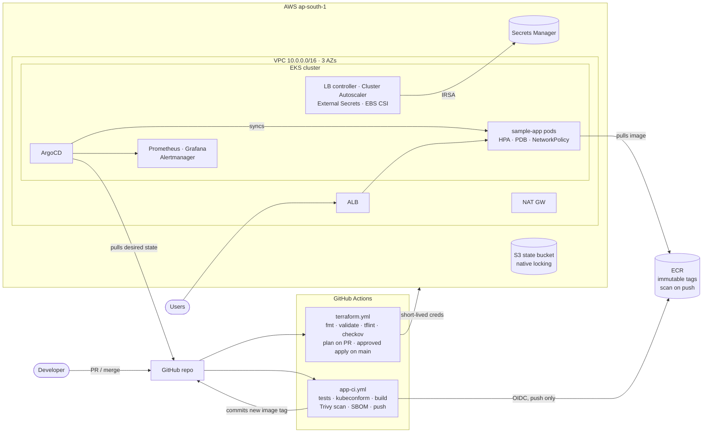

# EKS Production Platform

A production-style Kubernetes platform on AWS, built end-to-end with **Terraform**, **GitHub Actions** and **ArgoCD (GitOps)**. It's hardened by default, observable, autoscaling and cost-aware, and it uses **no long-lived AWS credentials anywhere**.

> Built to answer one question: *"What does it actually take to run workloads on Kubernetes in production?"*
> Every design choice is documented in [`docs/decisions.md`](docs/decisions.md), with the trade-off I accepted.

   

---

## Architecture



**Flow of a code change:** PR → tests, manifest validation, image build and Trivy scan → merge → image pushed to ECR → CI commits the new tag to `k8s/overlays/dev` → ArgoCD detects the commit → zero-downtime rolling update.
CI **never** holds cluster credentials. The cluster *pulls* from Git (the GitOps pull model).

---

## What's in it

| Area | Implementation | Why it matters |
|---|---|---|
| **Networking** | Custom VPC module (written from scratch): public/private subnets across 3 AZs, NAT (single for dev / per-AZ for prod), S3 gateway endpoint, VPC flow logs, default SG locked down | Nodes and pods have no public IPs; ECR layer pulls bypass NAT charges |
| **Cluster** | EKS 1.35 via `terraform-aws-modules/eks`, access entries (no `aws-auth` ConfigMap), KMS envelope encryption for Secrets, control-plane audit logs | Modern auth model; secrets encrypted at rest |
| **Compute** | Two managed node groups: on-demand `system` for platform components, **Spot** `apps` across 4 instance types | ~70% cheaper app capacity with interruption resilience |
| **Identity** | IRSA: one least-privilege IAM role per controller, bound to a single ServiceAccount. GitHub OIDC for CI: plan role (read-only, PRs) vs apply role (only from the approved `production` environment) | Zero static keys; blast radius per component |
| **IaC pipeline** | fmt → validate → tflint → checkov (SARIF to Security tab) → plan posted on the PR → manual approval → apply | Reviewable infra changes, policy-as-code |
| **App pipeline** | ruff + pytest → kubeconform (incl. CRDs) → Docker multi-stage build → Trivy (fail on fixable HIGH/CRITICAL) → CycloneDX SBOM → ECR push → GitOps commit | Supply-chain hygiene, shift-left security |
| **GitOps** | ArgoCD app-of-apps with sync waves (config → monitoring CRDs → apps), auto-sync, self-heal, prune, cascade-delete finalizers | Git is the single source of truth; drift is auto-corrected |
| **Workload hardening** | Non-root, read-only root FS, all capabilities dropped, seccomp `RuntimeDefault`, Pod Security Admission `restricted`, default-deny NetworkPolicy (enforced by VPC CNI) | Passes `restricted` PSS; limits impact of a compromised container |
| **Reliability** | Startup/liveness/readiness probes, `maxUnavailable: 0`, PDB, topology spread across AZs + nodes, `preStop` delay for ALB deregistration, graceful shutdown | Zero-downtime deploys and node drains |
| **Scaling** | HPA (CPU, with scale-down stabilization) + Cluster Autoscaler (least-waste expander) | Pods scale, then nodes follow |
| **Observability** | kube-prometheus-stack, app `/metrics` via ServiceMonitor, SLO-style alerts (5xx rate, p95 latency), structured JSON logs | You find out before users do |
| **Secrets** | External Secrets Operator → AWS Secrets Manager, IAM scoped to `eks-platform-dev/*` | No secrets in Git |
| **Cost** | Spot, single NAT in dev, gp3 default StorageClass, ECR lifecycle policy, prefix delegation (more pods/node), safe `make destroy` | See [cost](#cost) |

---

## Repository layout

```
.
├── terraform/
│   ├── bootstrap/            # one-time: S3 state bucket + GitHub OIDC + CI roles
│   ├── modules/vpc/          # hand-written VPC module
│   └── environments/dev/     # EKS, node groups, IRSA, ECR, Helm add-ons
├── gitops/
│   ├── bootstrap/root-app.yaml   # app-of-apps entry point (applied once)
│   ├── apps/                     # ArgoCD Applications (monitoring, config, sample-app)
│   └── platform-config/          # StorageClass, ClusterSecretStore
├── apps/sample-app/
│   ├── src/                  # FastAPI service with metrics, probes, JSON logs
│   ├── Dockerfile            # multi-stage, non-root
│   └── k8s/base + overlays/dev   # Kustomize
├── .github/workflows/        # terraform.yml, app-ci.yml
├── docs/                     # decisions (ADRs), runbook, interview guide
└── Makefile                  # make help
```

---

## Getting started

### Prerequisites
AWS account with admin access · AWS CLI v2 · Terraform ≥ 1.10 · kubectl · a GitHub repo (public recommended: code scanning is free)

### 1. Fork and point GitOps at your repo
```bash
make set-repo REPO=<your-github-user>/eks-production-platform
```

### 2. Bootstrap (once, local state)
```bash
make bootstrap REPO=<your-github-user>/eks-production-platform
```
This creates the state bucket, the GitHub OIDC provider and the plan and apply CI roles.

### 3. Configure the dev environment
```bash
cp terraform/environments/dev/terraform.tfvars.example terraform/environments/dev/terraform.tfvars
# fill in values from the bootstrap outputs + your IAM ARN (aws sts get-caller-identity)
make init plan apply          # ~15-20 min
make kubeconfig
kubectl get nodes -L workload,eks.amazonaws.com/capacityType
```

### 4. Hand over to GitOps
```bash
make argocd-bootstrap
kubectl -n argocd get applications -w     # wait for Synced/Healthy
```

### 5. Wire up CI/CD
In **GitHub → Settings → Secrets and variables → Actions → Variables**, add:

| Variable | Value |
|---|---|
| `TF_STATE_BUCKET` | bootstrap output `state_bucket` |
| `TF_PLAN_ROLE_ARN` / `TF_APPLY_ROLE_ARN` | bootstrap outputs |
| `GITHUB_OIDC_PROVIDER_ARN` | bootstrap output |
| `CLUSTER_ADMIN_ARNS` | JSON list, e.g. `["arn:aws:iam::123456789012:user/me"]` |
| `AWS_APP_CI_ROLE_ARN` | dev output `app_ci_role_arn` |

Then in **Settings → Environments**, create `production` and add yourself as a **required reviewer**.
Push any change under `apps/sample-app/`. The pipeline builds and scans the image, pushes it, and bumps the tag, then ArgoCD deploys it.

```bash
make app-url        # public ALB URL
make argocd-ui      # http://localhost:8080
make grafana        # http://localhost:3000  (admin / see gitops/apps/kube-prometheus-stack.yaml)
```

### 6. Tear down (do this when you're done!)
```bash
make destroy
```
This deletes the ArgoCD apps first, so the ALB and EBS volumes created inside the cluster are removed, and then runs `terraform destroy`. See [why the order matters](docs/runbook.md#teardown).

---

## Cost

Approximate cost in `ap-south-1` if you leave it running:

| Item | ~USD/month |
|---|---|
| EKS control plane | 73 |
| 2× t3.large on-demand (system) | 130 |
| 1× t3.medium Spot (apps) | 12 |
| NAT gateway (single) + data | 45 |
| ALB | 20 |
| EBS (gp3, 25 GiB) + CloudWatch logs | 5 |
| **Total** | **≈ $285/month ≈ $9.50/day** |

**Recommended:** bring it up, demo or screenshot, and run `make destroy` the same day. A 4-hour session costs about **$1.50**. Set an [AWS Budget alert](https://docs.aws.amazon.com/cost-management/latest/userguide/budgets-create.html) before you start.

---

## Security model at a glance

- **No static credentials:** GitHub → AWS through OIDC. Trust policies are pinned to this repo; the apply role only accepts tokens from the approval-gated `production` environment, and the app role only from `main`.
- **Least privilege:** each controller has its own IRSA role, and the app CI role can push to exactly one ECR repository.
- **Defense in depth for pods:** PSA `restricted`, non-root, read-only FS, no capabilities, default-deny NetworkPolicy.
- **Supply chain:** pinned tool versions, immutable image tags, Trivy gate, SBOM per build, ECR scan-on-push.
- **Audit:** EKS API, audit and authenticator logs; VPC flow logs (REJECT traffic).

Accepted trade-offs (public API endpoint, admin apply role, and others) are listed in [`.checkov.yaml`](.checkov.yaml) and [`docs/decisions.md`](docs/decisions.md).

---

## Roadmap

- [ ] `prod` environment: per-AZ NAT, private-only API endpoint with self-hosted runners in the VPC
- [ ] Karpenter in place of Cluster Autoscaler
- [ ] HTTPS: ACM + external-dns + cert on the ALB
- [ ] Progressive delivery with Argo Rollouts (canary gated on Prometheus metrics)
- [ ] Policy-as-code in the cluster (Kyverno: require probes/limits, block `:latest`)
- [ ] Logs with Loki, traces with OpenTelemetry
- [ ] Velero backups; Kubecost

---

## Docs
- [`docs/decisions.md`](docs/decisions.md): architecture decision records (the *why*)
- [`docs/runbook.md`](docs/runbook.md): operations, troubleshooting, teardown
- [`docs/interview-guide.md`](docs/interview-guide.md): how to present this project
